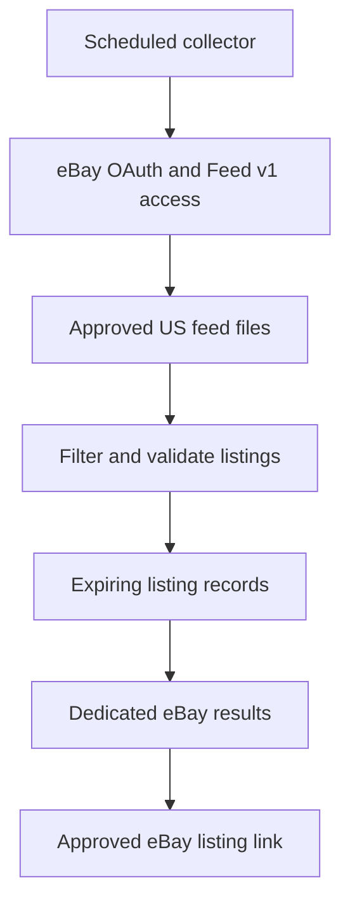

# Stage 2.3 — Official recurring merchandise feed activation

Baseline: Site 14, managed source a4641cb36eadafdeae9276b4e6f1fcd4fc568011; GitHub ebce6239fb5a990affc519022581a73cea087c8e. All earlier product, listing, personal and authentication records are preserved. One append-only migration adds a separate current merchant-feed table and FTS5 triggers. It does not rewrite the reference catalog.

## Source permission evidence

Wildmart's official https://wildmart.md/acp/docs/ explicitly publishes recurring offline full-replacement feeds, instructs consumers to refresh them, remove omitted IDs, verify SHA-256 and avoid current stock/price claims after 30 minutes. The linked ACP specification describes indexing and presentation of supplied product/variant media. This is materially stronger evidence than the previously evaluated shopper REST endpoint. It permits this current feed integration; it does not establish unrestricted historical redistribution or resale of images. Merchant media are remote references shown beside that merchant's exact listing and source ID. No image copies or derivatives are stored. Source suspension hides results and stops checks.

Live feed inspection on November 9 UTC / November 8 Eastern validated **98,813 records, 183,196,194 bytes**, digest **986e6587d4933a8fb67032795a488badbd70ab1f2921af413dd6ce33f30e3ddf**, snapshot 04:17:21 UTC. Streaming took **16.08 seconds**. The broad prefilter retained **69 candidates**; production classification decides final accepted counts. This inspection alone is not production collection evidence.

## Execution and retention

The existing authenticated GitHub scheduler checks the source on each execution and downloads a complete Romanian snapshot only when six hours are due. It verifies the merchant digest, byte count and record count before transmitting the small relevant subset. Invalid or interrupted downloads cannot publish. No complete source snapshot or image is written to disk, GitHub artifacts, repository or the permanent reference backup.

Stable merchant SKU and variant IDs drive transactional upserts. A successful full replacement removes omitted current-feed items and their FTS entries. Source failures retain prior correct records. Removal above 50% pauses publication for investigation. Concurrent source configuration changes abort the transaction. Execution metrics retain only 30 bounded summaries. A failed attempt backs off 1–6 hours; public cards hide after 24 hours without refresh. Prices and stock expire after 30 minutes, including while the page is open. Final buying decisions follow the merchant link.

The image pipeline uses variant-level merchant media first and product-level media only when exactly one source variant exists. It rejects non-approved image hosts. Five pending images per maintenance run receive bounded HEAD/content-type checks; only successful checks publish. Image matching never transfers photographs to another retailer's or historical product. Broken or failed images remain unpublished. Checks retry after seven days; subsequent full snapshots retain previously verified unchanged image URLs.

The new public collection is independently paginated, FTS-searchable and filtered by the same fourteen interests. It preserves MDL and explicitly states Moldova delivery and unknown US eligibility. The original 74-record reference/personal catalog remains separate. Favorites and gift-list attachment for current-feed items are not yet implemented.

## Cost and limits

No added service, account, subscription, paid inference or billing is required. Existing Sites hosting remains a dependency. GitHub confirms standard hosted runners are free for public repositories: https://docs.github.com/en/actions/reference/runners/github-hosted-runners . The collector uses ubuntu-latest, an eight-minute job timeout, streaming memory, no build or artifact upload, a 350 MB maximum download, a 240-second stream deadline, at most 1,500 relevant candidates and a 2 MB ingestion limit. Current scale is about 733 MB/day inbound to Actions at four full snapshots/day. This avoids loading a 183 MB source file into a 128 MB Worker. At 69 retained records, snapshot upserts are approximately 276/day plus FTS/config changes and image checks. Source APIs and authenticated endpoint calls have separate small budgets. GitHub schedule delays and 60-day public-repository inactivity remain operational dependencies; dashboard execution timestamps disclose actual operation.

## Verification status

Local end-to-end SQLite tests cover exact variant/price normalization, stable IDs, FTS, full replacement, stale generations, duplicates, unsafe links, mass-removal preservation, and automatic photo publication only after valid image responses. Production deployment and independent scheduled retrieval must be recorded below before claiming live activation. All fourteen interests retain configurations; actual source coverage is not assumed to cover every interest. Existing historical-photo backfill remains 74 processed, five uncertain candidates and zero automatic exact matches.

## First actual unattended production execution

GitHub run [42562419922](https://github.com/jordan61-dot/Sweetheart-Finds/actions/runs/42562419922) completed successfully on November 9 at 04:32:54 UTC (November 8, 23:32 Eastern). Trigger: **push**, not cron. Its collector downloaded and verified all 98,813 records in **3.33 seconds on the GitHub runner**, then published **69 new current-feed merchandise records**, with **69 exact source-variant image candidates**. Production database publication occurred at 04:32:52.678 UTC. Five images were independently checked and automatically published at 04:32:53–54. This is real unattended end-to-end publication; a separate cron execution still needs to be observed for the newly activated source.

Production GET `/api/merchant-feed` independently confirmed 69 stored records. Full-snapshot next eligibility was 10:32:52 UTC. The initial Site 15 frontend had a misplaced React client directive and returned a page error while its API remained operational. The directive was corrected and Site 16 restored the page at 04:34:36 UTC. The correction is GitHub commit `8630e1fd431203141d6956f2e0bbd83474f47f92`, managed source `4e5e709ca2f116f39c1c5180391235cc9e3ff110`. No data loss occurred.

## Additional automation

The next continuation adds rotating detail checks for up to twenty stale source IDs per workflow execution, paced at 1.2 seconds/request. The merchant expressly asks feed consumers to use live product lookups; these checks update only existing feed IDs and retain prior values on failures. A valid live response updates price, stock and source-observation time without duplicating the item. HTTP 429/503 stops the remaining batch. The original merchant images are not replaced by unrelated API search photos.

The workflow also drains up to fifteen five-image batches, six seconds apart, so the initial 69-image queue can finish automatically in one bounded execution. It stops as soon as no more images need checking. Every batch retains a production execution record. This remains checkpointed, with no requirement for the owner to press update repeatedly. Total job timeout stays eight minutes. These refinements pass 87 JavaScript tests; production evidence follows publication.

## November 15 production verification

Site 17 deployed at 04:37:37 UTC on November 9 (November 8, 11:37 p.m. Eastern), managed commit `691573368ea250ac773f0c8d88daa825922bc48c`. GitHub `cf05719d78645d155e7f68a9c31a8ef37ca957a8` synchronizes that implementation and activates the live SKU refresh in Actions.

Production history records 20 successful full imports from cron since activation. Latest recorded full import at this check was [43673187599](https://github.com/jordan61-dot/Sweetheart-Finds/actions/runs/43673187599), November 14 at 10:37 p.m. Eastern. It validated 99,180 source records and retained 69 distinct offers with zero additions, updates, removals or duplicates in that generation. Next eligible full import was November 15 at 4:37 a.m. Eastern, subject to scheduler delays.

The matching push-triggered [workflow run 43686659898](https://github.com/jordan61-dot/Sweetheart-Finds/actions/runs/43686659898) verified 20 live SKU responses at 1:42 a.m. Eastern on November 15. Public pagination confirmed 19 in-stock, one out-of-stock and 49 stale records afterward. A distinct cron execution of the new rotating refresh was not yet observed. All 69 current-feed records have verified exact merchant photo references. The scheduled snapshot and associated photo maintenance have real production execution evidence.

Current merchant results include 35 Monster High, 27 My Little Pony and seven Hello Kitty offers. The same seven Hello Kitty offers also count under Sanrio. The other ten interests retain historical and external search coverage. The canonical catalog remains 74 products. Historic photo backfill remains at five review candidates with no exact assignments. The original 34 offers were separate from the 69 current-feed offers.

[GitHub verification 43686659850](https://github.com/jordan61-dot/Sweetheart-Finds/actions/runs/43686659850) passed for the synchronized implementation. Local release validation passed 87 JavaScript, 10 database and four diagnostics tests plus TypeScript and build. Production frontend rendering recovered in Site 16 and was verified with genuine product cards. Additional spending remains $0 with existing Sites hosting and a public GitHub repository.

The core unattended publication and merchant-photo objectives are operational. The full Stage 2.3 scope remains incomplete, including broader authorized merchant and US shipping coverage, exact photographs for legacy records, and saving the separate merchant results to personal collections. Stage 3 has not started.

## Full-catalog stock refresh

GitHub commit `bb1329ac3c98414d734d2ccf2fb2a2520525ec1f` expands the existing workflow to four batches of up to 20 stale offers, with two seconds between lookups and a 170-second budget for starting requests. It stops further lookups on HTTP 429 or 503. The workflow change runs against Site 17 and needs no new site deployment. [Collector run 43686980684](https://github.com/jordan61-dot/Sweetheart-Finds/actions/runs/43686980684) verified all 49 remaining stale offers in three batches. A production read immediately afterward found 68 in stock, one out of stock, zero stale and 69 verified photo references. [CI run 43686980694](https://github.com/jordan61-dot/Sweetheart-Finds/actions/runs/43686980694) passed. GitHub scheduler delays can still exceed the 30-minute freshness window. Broader Stage 2.3 scope remains incomplete.

## Snapshot failure recovery

Collector commit `a7274250fa5f0b38a42e1e55aa639869742846c2` keeps existing-offer refresh and photo maintenance running after a full snapshot fails, records the source error and preserves a failed workflow result. A simulated download outage verified that the failure report, stock update and photo maintenance all execute in order. The normal production [collector run](https://github.com/jordan61-dot/Sweetheart-Finds/actions/runs/43687962070) and [foundation verification](https://github.com/jordan61-dot/Sweetheart-Finds/actions/runs/43687962147) passed. The change runs in GitHub Actions and requires no new site deployment or spending.

## Additional feed activation

Prioritize merchant consent over another general-purpose crawler. The current scheduler already supports authorized JSON and CSV feeds, conditional retrieval, leases, retries, product/variant identity, matching, and source-linked photography. An existing export is sufficient when the merchant approves its use.

| Lead | Verified access condition | Next action |
| --- | --- | --- |
| eBay Browse API | Production Buy API use requires an approved application. Official bulk feeds target eligible partners. | Apply for Browse production search and item lookup first. Request the exact display, image and caching rules for the approved use before enabling recurring collection. |
| HobbyLink Japan | Official affiliate program provides a merchant contact path. A recurring product export and reuse rights are unverified. | Ask for a feed and US shipping fields. |
| Independent specialty retailers | Current owner-configured JSON/CSV integration accepts permissioned exports. | Ask for an existing export limited to relevant merchandise and confirm refresh and display rights. |
| Disney Store via CJ | CJ advertises a product feed and requires an active publisher account and application. | Lower priority since fit with the 14 collections is unverified. |
| Agentsfeed and ACP directories | Protocol documentation describes public feed routes. It does not identify a relevant consenting merchant by itself. | Evaluate individual merchant listings when a matching catalog is found. |

Official evidence:
- https://developer.ebay.com/api-docs/buy/static/buy-requirements.html
- https://partnernetwork.ebay.com/solutions/scale-listings-on-your-site-with-data-feeds
- https://support.hlj.com/hc/en-us/articles/360006252733-Do-you-have-a-partnership-sponsorship-or-affiliate-program
- https://public.cj.com/signup/publisher?advertiserId=2609575

### Ready-to-send merchant request

Subject: Product feed for Sweetheart Finds

Hello, I’m looking to feature your relevant collectibles on Sweetheart Finds, a small shopping discovery site that links buyers directly to the original store. Do you offer an existing JSON or CSV catalog export for periodically refreshing product names, SKU or variant IDs, listing URLs, prices, and stock? We’re especially interested in Sanrio, Monster High, Littlest Pet Shop and related collectibles. If you offer a feed, please share its documentation, US shipping coverage, allowed refresh interval, and retention terms. Please also confirm whether we can display your supplied product image URLs alongside the corresponding listings. We can launch with listing text and links if photo display is unavailable. Site: https://sweetheart-finds.jordanmullens12.chatgpt.site

### eBay production application description

Sweetheart Finds helps shoppers discover character merchandise and vintage collectibles across 14 interests. We request production Browse search and item lookup access for relevant eBay listings, including listing identity, item condition, price/currency, availability, shipping to the United States and images when permitted. Buyers complete orders on eBay. We will attribute listings, link to the approved eBay destinations, follow freshness, retention and image rules, and keep partner credentials server-side. Please confirm whether recurring refresh of a bounded relevant listing set is permitted and, if so, the required retention window.

### When access is issued

1. Record the merchant's exact refresh, indexing, retention and image permissions. Continue with text and links if only that use is approved.
2. For a compatible feed, allowlist its exact HTTPS hostname and any separately approved image hosts in Sites, then register it in Catalog Studio. Use a targeted export of at most 250 records and 1.5 MB, or build a dedicated streaming adapter for larger feeds.
3. Verify one new real listing and one stable-ID refresh in production, then check the next scheduled execution. Use secure runtime configuration for credentials if the source requires them.

No additional merchant has been activated by this evaluation. A confirmed approved feed or production credentials are still needed. No applications or external messages were sent.

## November 16 scheduled production verification

- [Scheduled detail refresh 43822741899](https://github.com/jordan61-dot/Sweetheart-Finds/actions/runs/43822741899) verified all 69 existing offers in four batches (20, 20, 20, 9). This independently verifies the expanded refresh on cron.
- [Scheduled snapshot 43844521661](https://github.com/jordan61-dot/Sweetheart-Finds/actions/runs/43844521661) published at 4:58 a.m. Eastern. The runner validated 99,181 upstream records and 186,585,684 bytes in 3.21 seconds. The import retained 69 offers with zero reported additions, changes or removals. Photo maintenance verified ten due image references.
- A production read across all three pages found 69 unique IDs, 69 verified photo references, 68 in-stock offers, one out of stock and zero stale at 5:06 a.m. Eastern. A second read returned the same ID set. Independent search queries returned 35 Monster High, 27 My Little Pony and 7 Hello Kitty offers. This is a point-in-time check. Actual cron delays can exceed Wildmart's 30-minute freshness window, so expired prices and stock continue to be hidden. US shipping remains unverified.
- [Workflow change 7033a98](https://github.com/jordan61-dot/Sweetheart-Finds/commit/7033a9825e9d38bb6d91a249f17120e3fd7da09a) allows the independent maintenance step to run after a Wildmart step failure. GitHub still records the failed Wildmart step and fails the job. This gives future authorized feeds a maintenance pass even when the Wildmart collector exits early. The [production push run](https://github.com/jordan61-dot/Sweetheart-Finds/actions/runs/43845705131) and [foundation CI](https://github.com/jordan61-dot/Sweetheart-Finds/actions/runs/43845705073) passed. No live outage was induced. Local verification passed 87 JavaScript tests, 10 database tests, four diagnostics tests and TypeScript. This workflow-only change uses the existing live site and database with $0 additional required cost.

## Second-source activation evidence

### eBay Curated Item Feed

The US Curated Item Feed (Buy Feed API v1) is the submitted access request. A support acknowledgment has arrived. Production feed permission and keyset enablement are pending. Production key enablement and Buy API approval are separate. Follow [Buy API production requirements](https://developer.ebay.com/api-docs/buy/buy-requirements.html) and [marketplace account deletion instructions](https://developer.ebay.com/marketplace-account-deletion). The published opt-out is for applications that do not persist eBay data. Confirm the notification requirement before enabling a persisted feed integration. Rotate the previously exposed certificate before use and enter the replacement directly in a secure runtime secret. Do not include secrets or private account details in evidence.

Proposed data flow for review:

After written approval, use the server-side application token to query Feed v1 access and confirm the granted marketplace and categories before downloading any file. Process only granted files with bounded downloads, checkpoints and retry backoff. Keep the full REST item ID, including its variation component, as the source identity. An image supplied for a listing is evidence for that listing only. Keep the image a remote reference and display it only under granted terms. Confirm eligibility for price and availability refresh, how to identify removed listings, actual account limits, file cadence, approved links, image reuse and retention before publication.

The [general eBay API license, section 8](https://developer.ebay.com/develop/api-license-agreement) requires visually separate public eBay content, prompt removal from the application when no longer public, and limits on displayed listing age. Its six-hour listing-age rule is a display limit, not a blanket six-hour storage grant. Apply the approved program terms and any tighter limits. Keep eBay out of the generic combined merchant view and permanent exports unless the approved terms expressly allow those uses. For approval screenshots, capture the live site's current search and merchant attribution, label eBay screen designs as proposed, and exclude admin panels and personal data. Official references: [Feed access and file retrieval](https://developer.ebay.com/api-docs/buy/static/api-feed.html) and [curated item schema](https://developer.ebay.com/api-docs/buy/feed/v1/schema/curated_item_feed).

### Specialty retailers

[Kidrobot](https://www.kidrobot.com/pages/kidrobot-affiliate-program) expressly offers a product catalog to approved Impact publishers. Its [Sanrio collection](https://www.kidrobot.com/collections/sanrio) confirms Hello Kitty and My Melody coverage. Access through Impact is currently unavailable. A direct retailer authorization would need to provide an official feed URL and confirm automated refresh, stock/price fields, shipping information, image reference rights, and retention. Keep [HobbyLink Japan](https://support.hlj.com/hc/en-us/articles/360006252733-Do-you-have-a-partnership-sponsorship-or-affiliate-program) as an independent contact path. No specialty retailer feed or photo rights have been activated from these leads.

Stage 2.3 remains incomplete. A second authorized production feed, broad exact-photo coverage for the 74 reference products, and merchant-offer saving to favorites and gift lists remain open.

## Merchant offers in personal collections

Version 20 adds favorite and gift-list controls to Wildmart's live offer cards. The existing account and browser persistence, operation queue, and personal backups use the existing offer ID and a title bookmark. No database migration is required. Saved pages check current availability in bounded batches and keep a bookmark if its offer drops out of the feed. Saved bookmarks carry no photograph, source URL, price, or stock observation. Live retailer links are returned only for offers still present in an active feed.

The source also includes a local, offline Curated Item Feed diagnostic. Synthetic tests confirmed distinct variation identities, expired offers and rejection of conflicting duplicates. It makes no eBay requests and publishes no listings. Feed approval, verified categories, actual file cadence, refresh and removal rules, and approved display and image reuse remain prerequisites for unattended integration.

Local validation passed 88 JavaScript tests, 10 database tests, TypeScript and the production build. The live browse page showed favorite and gift-list controls. Live account mutation was left untested to avoid changing existing personal data. The project uses existing Sites hosting with no added charge. Stage 2.3 remains incomplete pending a second authorized feed and broader exact photography for reference products.

## Product image review

Exact-product reference thumbnails can be evaluated individually. Consider a small image that links straight to its source and helps users identify or distinguish a variant. Record the exact SKU or other identity evidence, image source and rights basis, why the display is needed, and whether it serves as a substitute for the original image. Check applicable source and feed terms independently. Honor explicit restrictions and provide a way to remove a disputed image. Automatic publication continues to use the rights granted by each feed or documented license. A thumbnail that is visually similar is insufficient proof of a product or variant match.

The U.S. Copyright Office summarizes an example where a court found search-engine thumbnails used as pointers to source material supported fair use. That decision involved a general-purpose search engine and does not decide the outcome for a product catalog. [Perfect 10 v. Amazon summary](https://www.copyright.gov/fair-use/summaries/perfect10-amazon-9thcir2007.pdf)

Mattel's official page establishes an exact candidate for the 2026 Fang Vote Abbey Bominable product. It is a first candidate for review of a source-linked identification thumbnail. A publication decision remains open. [Mattel product page](https://creations.mattel.com/pages/monster-high-2026-fang-vote-abbey-bominable-doll)

## November 16 production follow-up

- Signed eBay Marketplace Account Deletion delivery succeeded in production with HTTP 204. A separate read-only production Feed v1 check returned access error 1100 for the base OAuth token. The documented `buy.item.feed` OAuth scope was denied as `invalid_scope`, so the current key cannot fetch Curated Item Feed files. Support acknowledgment has arrived, with no grant observed.
- Version 20 was tested with a signed-in production account. One live merchant favorite and one temporary gift-list entry survived navigation and reload and displayed the current offer. Both test changes were removed, and the app confirmed account sync. Existing personal records were preserved.
- Aligned the offline eBay validator with the current schema. An end date is conditional, so a blank or omitted date is retained as unknown. Where the feed supplies a direct listing link, the validator retains an HTTPS eBay URL separately from the conditional affiliate link. Synthetic fixtures covered optional end dates, expiry and variant identity. No listings were imported.
- Schylling advertises an official Image Bank through wholesale sales support. Its asset access is gated and Sweetheart Finds reuse rights remain unverified. Eleven existing Schylling product records already have source SKU evidence to use for matching after permission. [Official wholesale and image bank](https://schylling.com/wholesale/)

Stage 2.3 remains incomplete pending a second authorized live feed and broader exact-photo coverage. All work in this follow-up required $0 additional spending.

### Schylling Image Bank access check

A registered account successfully authenticated on November 16. The signed-in library showed zero photos. The official Littlest Pet Shop keyword was visible, and following it returned an authorization denial. The gallery About page provided no image reuse terms. No gated assets were retrieved or published. The eleven exact Schylling SKU records remain ready for matching once an authorized asset path and display conditions are confirmed. Schylling lists its sales support contact on the [official wholesale page](https://schylling.com/wholesale/).

## November 21 — edition cover verification and photo review

The public catalog, individual product view and saved-record lookup now identify the pictured printing of 13 Open Library book records. Twelve preserve the edition represented by the previous cover identifier. For *Lights, Camera, Shopkins!*, the original ISBN 9781484470459 cover request returned HTTP 404. The work also lists the Scholastic edition, ISBN 9780545940412. Its [edition record](https://openlibrary.org/books/OL28583526M) assigns cover 10408106, which served a JPEG. The work-level view labels it as that edition. A record explicitly identifying another printing retains its own gallery. Other missing images show a source link and an availability message on the detail page.

The mappings were checked against individual edition records for work ID, edition ID, ISBN and cover ID. They are a public display projection. Catalog IDs, raw galleries, bookmarks, notes, image expiry and private backups retain their original records. No cover bytes are stored, no new scheduled image fetch is added, and no book artwork is counted as a verified toy photograph. [Open Library public cover-display guidance](https://openlibrary.org/dev/docs/api/covers) · [rights information](https://openlibrary.org/developers/licensing).

The five pending Commons candidates were reviewed and rejected through the production Catalog Studio. For the *Monster High* book they depicted a convention display and people at Comic-Con. For *Hello Kitty, Hello Love!* they depicted event clothing and two aircraft liveries. The dashboard confirmed zero awaiting review. None of these appeared in a product gallery.

Pludor documents a public shopping discovery feed, while section 6 of its [terms](https://pludor.com/tos) requires written consent for automated tools. The scope of independent recurring collection and caching is unresolved. No Pludor collector was activated. Wildmart remains the verified production merchant. Broader exact-product photography and a second authorized live feed remain open. This release uses the existing Sites deployment and public repository, with no added dependency, paid service, scheduled job or database migration.

## Retailer XML, RSS and Atom feeds

The registered retailer collector now accepts product XML, RSS 2.0 and Atom 1.0. The source owner can configure these formats in Catalog Studio under the existing recurring and durable permission agreement. A SQLite integration test imports a fixture through registration, updates a price under the same product identity and confirms that malformed replacement XML preserves the existing offer. See [participating retailer integration](PERMISSIONED_FEEDS.md#authorized-xml-exports) for the supported fields and an XML example. These formats do not activate a merchant, publish photos or change source permissions.

## Photo decision queue

Catalog Studio opens photo decisions with active products awaiting review. The owner can switch to the full decision history, including prior rejections and records whose products were archived. Both views display 20 decisions per page. The queue count and pending view use the same eligibility rules, so prior decisions cannot push new candidates out of reach.

## Feed configuration and permission changes

When a registered feed configuration changes, the next collection starts with a fresh download under the new mapping and permission settings. It discards the old checkpoint and HTTP validators while preserving existing catalog records, the daily request budget and execution history. A concurrent collector lease blocks configuration edits. Expired permissions stop new scheduled requests, and permission must still be valid when a collector commits a page.

## Retailer galleries and collection order

The retailer collector verifies each supplied photo against the exact source product and variant. A checkpoint processes up to ten products and makes at most twelve photo requests. When it reaches the budget, the next run resumes with the next product. Existing gallery entries count toward the twelve-photo product limit. Failed feed verifications remain in the decision history and can be retried by the collector. Scheduled collection processes the longest-waiting eligible feeds first.

## Image audit and scheduler reporting

The availability audit follows the catalog's public edition-cover selection. Coverage counts use that same URL, so an old ISBN audit cannot label the displayed edition cover broken. A check whose gallery changes in flight is discarded. Same-origin redirects share a five-second deadline, and maintenance warnings show outcomes from the current audit batch. Owner-triggered maintenance leaves the next scheduled deadline intact.
